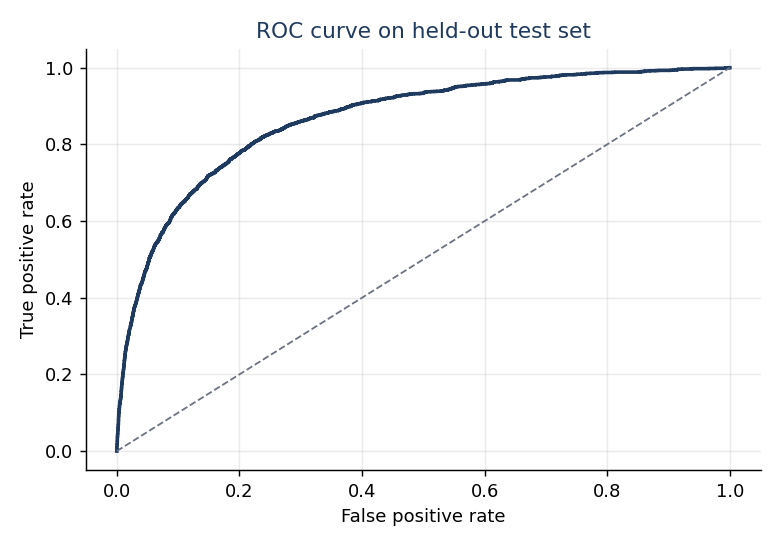
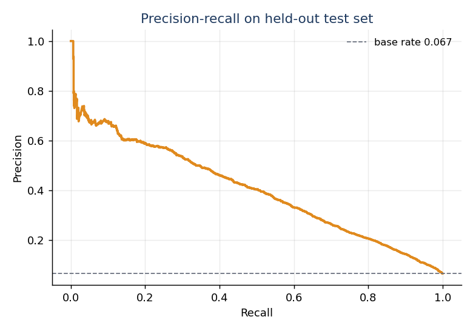
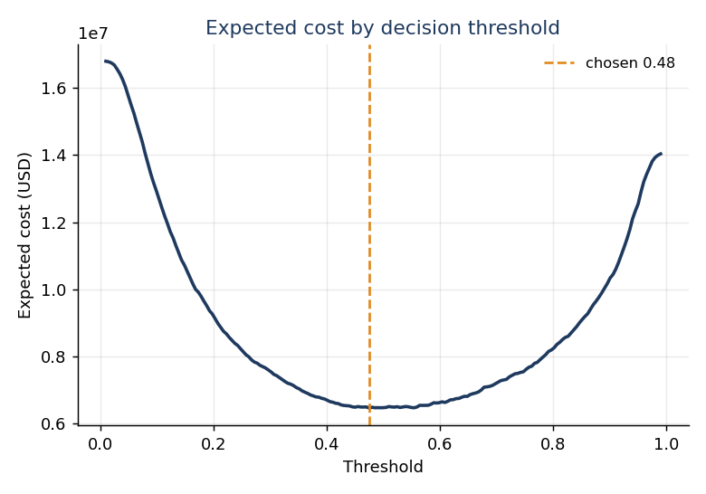
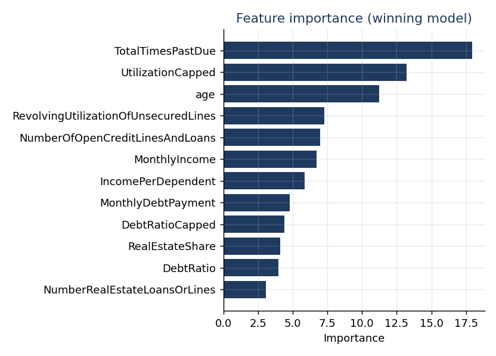
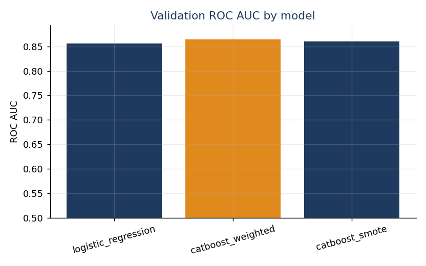

# riskbeacon

[](https://github.com/ranjithguggilla/riskbeacon/actions/workflows/ci.yml)

An early-warning scorer that estimates the probability a borrower falls into
serious financial distress within two years, and turns that probability into an
approve or decline call using the actual dollar cost of each kind of mistake.

Most credit-scoring write-ups stop at a ROC AUC number. That number tells you
how well the model ranks borrowers, but it does not tell a lending team where to
draw the line, and it hides the fact that a missed default costs far more than a
declined good customer. riskbeacon carries the cost of each error all the way
through to the threshold, so the output is a decision you can defend in a review,
not just a score.

## what it does

- Cleans the known data-entry problems in the raw file (sentinel delinquency
  counts of 96 and 98, an applicant with age 0) before anything else touches it.
- Runs all preprocessing inside the model pipeline, so median imputation and
  scaling are fit on the training fold only and never peek at the test data.
- Compares a class-weighted logistic baseline against two gradient-boosted
  models and lets the numbers pick the winner.
- Sets the approve/decline threshold by minimising expected loss in dollars, not
  by defaulting to 0.5.
- Explains every score with short, rule-based reasons a loan officer can read.
- Ships a small Gradio app that is a thin shell over the same scoring function
  the tests exercise.

## results

Numbers below come from a held-out test set of 30,000 applicants that played no
part in model selection or threshold tuning. The full dump lives in
`metrics.json` and is regenerated on every training run.

Model comparison on the validation fold:

| model | roc auc | average precision |
|-------|---------|-------------------|
| logistic_regression | 0.856 | 0.358 |
| catboost_weighted | 0.864 | 0.390 |
| catboost_smote | 0.860 | 0.375 |

The class-weighted CatBoost model won, though only by about eight thousandths of
ROC AUC over the logistic baseline. If I needed maximum transparency for a
regulator I would not feel bad shipping the linear model instead; the gap is
small and honest.

Winning model on the test fold:

| metric | value |
|--------|-------|
| roc auc | 0.867 |
| average precision | 0.402 |
| brier score | 0.135 |
| recall at chosen threshold | 0.784 |
| precision at chosen threshold | 0.216 |
| chosen threshold | 0.475 |

The precision looks low on purpose. Because a missed default is priced at
$7,000 and a wrongly declined customer at $600, the cost-minimising threshold
happily accepts a lot of false alarms to catch more real defaults. At that
threshold the model flags 1,571 of the 2,005 actual defaulters in the test fold
and misses 434.

Business impact on the test fold, against a baseline of approving everyone:

| line | value |
|------|-------|
| cost of approving everyone | $14,035,000 |
| cost with the model | $6,463,400 |
| dollars saved | $7,571,600 |
| loss reduction | 53.9% |
| saved per applicant scored | $252 |

Assumptions behind those dollars, all set in `config.py` and easy to challenge:
exposure at default $10,000, loss given default 70%, two-year margin on a good
customer $600. Change them and the threshold moves with them.











## architecture

```
        raw csv (Give Me Some Credit)
                  |
                  v
      +-----------------------+
      |  data.clean_frame     |  cap 96/98 sentinels, fix age 0
      +-----------------------+
                  |
                  v
      +-----------------------+
      |  stratified split     |  train 90k / val 30k / test 30k
      +-----------------------+
                  |
        train fold only
                  v
   +-------------------------------+
   |   pipeline (fit on train)     |
   |   FeatureEngineer             |  row-wise, stateless
   |   -> SimpleImputer(median)    |  learned on train fold
   |   -> [SMOTE for one variant]  |
   |   -> model                    |  logistic / catboost
   +-------------------------------+
                  |
        pick winner on val AUC
        set threshold on val cost
                  v
      +-----------------------+
      |  evaluate on test     |  ranking + dollar metrics
      +-----------------------+
              |        |
              v        v
        metrics.json  assets/*.png
              |
              v
      riskbeacon.joblib  ->  scoring.score_applicant  ->  Gradio app
```

## installation

```bash
git clone https://github.com/ranjithguggilla/riskbeacon.git
cd riskbeacon
python -m venv .venv && source .venv/bin/activate
pip install -r requirements.txt
pip install -e .
```

## usage

Fetch the data (pulled from a public GitHub mirror, roughly 7 MB):

```bash
PYTHONPATH=src python -m riskbeacon.fetch_data
```

Train, compare models, and write the artifact plus charts:

```bash
PYTHONPATH=src python -m riskbeacon.train_pipeline
```

Score a single application from Python:

```python
from riskbeacon import ApplicantRecord, score_applicant
from riskbeacon.scoring import load_bundle

record = ApplicantRecord(
    RevolvingUtilizationOfUnsecuredLines=0.95,
    age=29,
    NumberOfTime30to59DaysPastDueNotWorse=2,
    DebtRatio=0.6,
    MonthlyIncome=2600,
    NumberOfOpenCreditLinesAndLoans=7,
    NumberOfTimes90DaysLate=1,
    NumberRealEstateLoansOrLines=0,
    NumberOfTime60to89DaysPastDueNotWorse=0,
    NumberOfDependents=2,
)
print(score_applicant(record, load_bundle()))
```

Launch the app:

```bash
PYTHONPATH=src python -m riskbeacon.app
```

## configuration

The knobs worth touching live in `src/riskbeacon/config.py`:

- `CostAssumptions.exposure_at_default`, `.loss_given_default`, `.approved_margin`
  drive the threshold and the savings figure.
- `RANDOM_STATE` fixes the split and model seeds for reproducibility.
- `Paths` holds every input and output location in one place.

Model choices (iteration count, tree depth, learning rate, the SMOTE variant)
are in `src/riskbeacon/model.py`.

## output structure

```
metrics.json                 every reported number, regenerated each run
models/riskbeacon.joblib     the winning pipeline plus its threshold
assets/roc_curve.png         held-out ROC
assets/pr_curve.png          held-out precision-recall
assets/cost_curve.png        expected cost across thresholds
assets/feature_importance.png
assets/model_comparison.png
```

## project structure

```
riskbeacon/
  src/riskbeacon/
    config.py          paths and the money assumptions
    data.py            load, clean, stratified split
    features.py        stateless feature engineering
    model.py           the three candidate pipelines
    evaluate.py        ranking metrics and cost analysis
    explain.py         plain-language reasons
    scoring.py         the single scoring entry point
    plots.py           chart rendering
    train_pipeline.py  end-to-end run
    app.py             Gradio front end
    fetch_data.py      data downloader
  tests/               pytest suite
  data/                raw csv lands here (git-ignored)
  assets/              generated charts
  models/              trained artifact (git-ignored)
```

## technical details

The three past-due counters use 96 and 98 as placeholders for a small group of
records. Left in place they distort every tree split and inflate the linear
coefficients, so `clean_frame` caps them to the largest believable count seen
below the sentinel band. Missing income is not dropped or blindly zero-filled;
`features.py` adds a `MissingIncome` flag so the model can learn whether a blank
income is itself informative, then median imputation fills the numeric hole
inside the pipeline.

Threshold selection is the part that usually gets skipped. `evaluate.cost_curve`
sweeps thresholds, prices each confusion matrix with the cost assumptions, and
`best_threshold` returns the cheapest point on the validation fold. That
threshold is then frozen and applied once to the test fold, which is why the
reported recall and precision are honest rather than tuned on the same data.

CatBoost with balanced class weights edged out both the logistic baseline and
the SMOTE variant. SMOTE helped recall a little but hurt calibration and average
precision, which lines up with the general experience that synthetic minority
samples are not a free win on tabular credit data.

## testing

```bash
ruff check src tests
pytest
```

The suite covers the sentinel capping, the split keeping the default rate stable
across folds, the feature engineer staying row-independent (a direct leakage
check), the cost arithmetic on hand-worked examples, and the full scoring path
including a risky application scoring above a clean one.

## dataset

Give Me Some Credit, the 2011 Kaggle competition dataset, 150,000 anonymised
consumer credit histories. Fetched from the public mirror at
https://github.com/vivekkalyan/give-me-some-credit. Credit to the original
competition organisers for releasing it.

## license

MIT, see [LICENSE](LICENSE).
